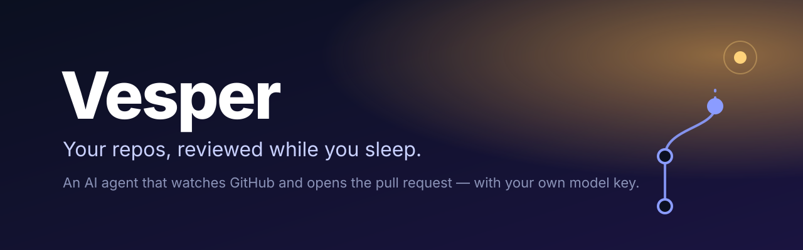
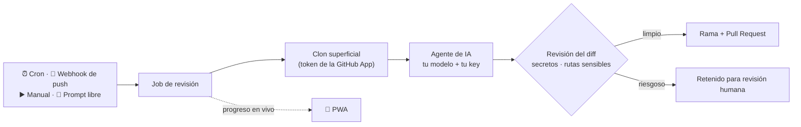

<p align="center">
  
</p>

<p align="center">
  <a href="LICENSE.md"></a>
  <a href="https://github.com/Jdrg4/vesper/actions/workflows/backend-ci.yml"></a>
  <a href="https://github.com/Jdrg4/vesper/actions/workflows/frontend-ci.yml"></a>
  
  
  
</p>

<p align="center">
  <a href="README.md">English</a> · <b>Español</b>
</p>

---

**Vesper es un agente de IA que vigila tus repositorios de GitHub y te abre pull requests.**
Le señalas un repo, eliges qué debe cuidar —seguridad, calidad del código, dependencias,
rendimiento o documentación— y él clona el código, hace el trabajo y te manda un PR para
revisar. Con un horario, en cada push o cuando tú se lo pidas.

El modelo lo pones tú. Vesper funciona con **174 proveedores** del catálogo de
[models.dev](https://models.dev) —OpenAI, Anthropic, Gemini, DeepSeek, Kimi, GLM, Qwen,
Mistral, Groq, OpenRouter y más— usando **tu propia API key**, guardada cifrada. Sin precio
por puesto, sin atarte a un proveedor, y en tu propio servidor.

> [!WARNING]
> **Está empezando.** El ciclo completo funciona (repo → agente → diff validado → PR), pero
> Vesper aún no está listo para producción: el aislamiento por contenedor de cada job llega
> en la próxima fase. Úsalo con tus propios repos, no como servicio público. Ver la
> [hoja de ruta](#hoja-de-ruta).

## Por qué Vesper

- 🔁 **Aparece solo.** Reglas con cron, webhooks de push de GitHub, un botón o un prompt
  libre: cuatro formas de poner a trabajar al agente, todas con las mismas salvaguardas.
- 🔑 **Tu key, cualquier modelo.** Un modelo que desarrolla y otro que revisa, por espacio
  de trabajo. Cambias de proveedor sin tocar código.
- 🧾 **Pull requests, no chat.** El resultado es una rama y un PR que puedes leer, probar y
  fusionar… o cerrar.
- 🛡️ **Salvaguardas antes del PR.** Cada diff se revisa antes de subir nada (ver
  [Seguridad](#seguridad)).
- 🏠 **Lo alojas tú.** Un solo `docker compose`: backend, worker, web, Postgres y Redis.
- 👥 **Multi-tenant desde el primer día.** Equipos, roles, cuotas por espacio y aislamiento
  estricto de datos.
- 📱 **Pensado para el móvil.** Una PWA para seguir los jobs y revisar resultados desde el
  teléfono.

## Cómo funciona



1. **Conecta**: instala la GitHub App de Vesper en los repos que quieras vigilar.
2. **Configura**: añade la API key de tu modelo y elige qué recibe cada repo: seguridad,
   calidad, dependencias, rendimiento o docs, con horario y/o en cada push.
3. **Revisa**: Vesper abre el PR. El botón de merge sigue siendo tuyo.

## Seguridad

Un agente que escribe en tus repos tiene que ganarse la confianza. Antes de que nada salga
del sandbox:

| Control | Qué pasa |
|---|---|
| **Secretos en el diff** | Se revisan las líneas añadidas en busca de keys de AWS, GitHub, Anthropic, OpenAI, Slack y Google, claves privadas, credenciales en cadenas de conexión y contraseñas en el código. Si aparece una, **no hay PR**: el job queda retenido. |
| **Rutas sensibles** | Los cambios en workflows de CI, `package.json`, `requirements.txt`, `pyproject.toml` o `.env` esperan a un humano. |
| **Acceso mínimo a GitHub** | Tokens de instalación de corta vida (`contents:write`, `pull_requests:write`, `metadata:read`), nunca un token personal. |
| **Entorno aislado del runtime** | El agente recibe un entorno en lista blanca: ningún secreto del servidor y solo las keys del espacio de trabajo en curso. |
| **Los fallos del modelo se ven** | Si el proveedor rechaza la llamada, el job falla con su mensaje en vez de fingir que no había nada que arreglar. |

## Arranque rápido

**Requisitos:** Python 3.12, Node 22 + pnpm, PostgreSQL 16+ (puerto 55432 por defecto), git y
el runtime del agente `opencode-ai` 1.x (`npm i -g opencode-ai@1.19.0`). Redis es opcional
en desarrollo.

```bash
git clone https://github.com/Jdrg4/vesper.git && cd vesper

# 1. Backend
cd vesper-backend
python3.12 -m venv .venv && source .venv/bin/activate     # Windows: .venv\Scripts\activate
pip install -r requirements.txt
cp .env.example .env
python scripts/create_github_app.py --name "Vesper Bot"   # crea TU GitHub App y rellena el .env
export PYTHONPATH=.
alembic upgrade head
python scripts/seed_test_users.py                          # usuarios demo, ver docs/test-users.md
uvicorn src.main:app --port 8000

# 2. Worker (cron + cola), en otra terminal
arq src.worker.WorkerSettings

# 3. Web, en otra terminal
cd vesper-frontend && cp .env.example .env.local && pnpm install && pnpm dev
```

Abre <http://localhost:3000>, entra con `admin@vesper.example` / `changeme123`, añade la key
de tu modelo en **Ajustes** y conecta GitHub y elige un repo en **Repositorios**.

### Autoalojarlo

Producción es un solo compose. Rellena [`.env.deploy.example`](.env.deploy.example) en tu
plataforma (Coolify, Dokploy, Docker a pelo…) y despliega
[`docker-compose.deploy.yml`](docker-compose.deploy.yml). Solo la web queda expuesta; la API,
el worker, la base de datos y Redis viven en la red interna.

## Hoja de ruta

| | Fase | |
|---|---|---|
| ✅ | **Fundación** | CI, pre-commit, migraciones |
| ✅ | **Auth y multi-tenancy** | JWT, roles, tests de aislamiento por tenant en cada módulo |
| ✅ | **GitHub App** | Instalación con verificación de propiedad, sync de repos |
| ✅ | **Runner del agente** | Clon → agente → diff validado → push → PR |
| ✅ | **Disparadores** | Cron, webhooks de push, manual, prompt libre, cuotas por plan |
| 🔨 | **Motor de agente propio** | Bucle de tool-calling nativo y un **entorno de desarrollo containerizado por job**: el agente instala dependencias, corre tu suite y Playwright, para que los PRs lleguen verificados y no solo plausibles |
| ⬜ | **Agente revisor** | Un segundo modelo revisa cada PR |
| ⬜ | **Pulido de la PWA** | Interfaz en inglés, notificaciones push, modo sin conexión |
| ⬜ | **Despliegue en un clic** | Configuración de producción endurecida |

## Construido con

**Backend:** FastAPI · SQLAlchemy 2 (async) · Alembic · Pydantic v2 · Arq · Redis · PostgreSQL ·
structlog. **Frontend:** Next.js 16 · React · Tailwind v4 · shadcn/ui · TanStack Query · Zustand ·
Zod. **Agente:** GitHub App + un runtime compatible con OpenAI/Anthropic, con
[models.dev](https://models.dev) como catálogo de modelos.

## Contribuir

Issues y pull requests son bienvenidos. Empieza por [CLAUDE.md](CLAUDE.md): es la guía del
proyecto (arquitectura, comandos, la regla de aislamiento multi-tenant, trampas conocidas y
la lista de comprobaciones antes de abrir un PR), y sirve uses o no un agente de código.
Las decisiones de diseño de cada fase están en [docs/superpowers/specs/](docs/superpowers/specs/).

Si Vesper te sirve, **una ⭐ ayuda mucho**: es como otros lo encuentran.

## Licencia

Vesper es **source-available** bajo la [Functional Source License 1.1](LICENSE.md)
(FSL-1.1-ALv2):

- ✅ Úsalo, modifícalo y alójalo tú mismo, también en tu empresa y para tus propios repos.
- ❌ No lo ofrezcas, ni una versión modificada, como producto o servicio que compita con él.
- ⏳ Cada versión pasa a **Apache 2.0** dos años después de publicarse.

<p align="center">
  <a href="https://star-history.com/#Jdrg4/vesper&Date">
    
  </a>
</p>
