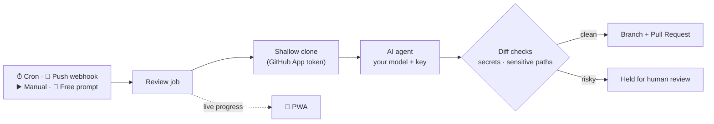

<p align="center">
  
</p>

<p align="center">
  <a href="LICENSE.md"></a>
  <a href="https://github.com/Jdrg4/vesper/actions/workflows/backend-ci.yml"></a>
  <a href="https://github.com/Jdrg4/vesper/actions/workflows/frontend-ci.yml"></a>
  
  
  
</p>

<p align="center">
  <b>English</b> · <a href="README.es.md">Español</a>
</p>

---

**Vesper is an AI agent that watches your GitHub repositories and opens pull requests.**
Point it at a repo, pick what it should care about — security, code quality, dependencies,
performance or docs — and it clones the code, does the work and sends you a PR to review.
On a schedule, on every push, or whenever you ask.

You bring the model. Vesper works with **174 providers** from the
[models.dev](https://models.dev) catalog — OpenAI, Anthropic, Gemini, DeepSeek, Kimi, GLM,
Qwen, Mistral, Groq, OpenRouter and more — using **your own API key**, encrypted at rest.
No per-seat pricing, no vendor lock-in, and it runs on your own server.

> [!WARNING]
> **Early days.** The end-to-end loop works (repo → agent → validated diff → PR), but Vesper
> is not production-ready yet: per-job container isolation lands in the next phase. Run it
> for your own repos, not as a public service. See the [roadmap](#roadmap).

## Why Vesper

- 🔁 **It shows up on its own.** Cron rules, GitHub push webhooks, a button, or a free-form
  prompt — four ways to put the agent to work, all with the same guardrails.
- 🔑 **Bring your own key, any model.** Pick a developer model and a reviewer model per
  workspace. Switch providers without touching code.
- 🧾 **Pull requests, not chat.** The output is a branch and a PR you can read, test and
  merge — or close.
- 🛡️ **Guardrails before the PR.** Every diff is scanned before anything is pushed (see
  [Safety](#safety)).
- 🏠 **Yours to host.** One `docker compose` file: backend, worker, web app, Postgres, Redis.
- 👥 **Multi-tenant from day one.** Teams, roles, per-workspace quotas, strict data isolation.
- 📱 **Mobile-first UI.** A PWA to follow jobs and review results from your phone.

## How it works



1. **Connect** — install the Vesper GitHub App on the repos you want watched.
2. **Configure** — add your model API key and choose what each repo should get: security,
   quality, dependencies, performance or docs, on a schedule and/or on push.
3. **Review** — Vesper opens the PR. You stay in charge of the merge button.

## Safety

An agent that writes to your repos has to earn trust. Before anything leaves the sandbox:

| Check | What happens |
|---|---|
| **Secrets in the diff** | Added lines are scanned for AWS, GitHub, Anthropic, OpenAI, Slack and Google keys, private keys, credentials in connection strings and hard-coded passwords. A hit means **no PR** — the job is held for review. |
| **Sensitive paths** | Changes to CI workflows, `package.json`, `requirements.txt`, `pyproject.toml` or `.env` are held for a human. |
| **Least-privilege GitHub access** | Short-lived installation tokens (`contents:write`, `pull_requests:write`, `metadata:read`) — never a personal token. |
| **Isolated runtime environment** | The agent gets an allowlisted environment: none of the server's secrets, and only the current workspace's model keys. |
| **Model failures are loud** | If the provider rejects the call, the job fails with the provider's message instead of pretending there was nothing to fix. |

## Quickstart

**Requirements:** Python 3.12, Node 22 + pnpm, PostgreSQL 16+ (port 55432 by default),
git, and the agent runtime `opencode-ai` 1.x (`npm i -g opencode-ai@1.19.0`). Redis is
optional for local development.

```bash
git clone https://github.com/Jdrg4/vesper.git && cd vesper

# 1. Backend
cd vesper-backend
python3.12 -m venv .venv && source .venv/bin/activate     # Windows: .venv\Scripts\activate
pip install -r requirements.txt
cp .env.example .env
python scripts/create_github_app.py --name "Vesper Bot"   # creates YOUR GitHub App, fills .env
export PYTHONPATH=.
alembic upgrade head
python scripts/seed_test_users.py                          # demo users, see docs/test-users.md
uvicorn src.main:app --port 8000

# 2. Worker (cron + queue), in another terminal
arq src.worker.WorkerSettings

# 3. Web app, in another terminal
cd vesper-frontend && cp .env.example .env.local && pnpm install && pnpm dev
```

Open <http://localhost:3000>, sign in as `admin@vesper.example` / `changeme123`, add your
model key in **Ajustes** (settings), then connect GitHub and pick a repo in
**Repositorios**. The UI is in Spanish for now — English is on the way.

### Self-hosting

Production is a single compose file. Fill in [`.env.deploy.example`](.env.deploy.example)
in your host (Coolify, Dokploy, plain Docker…) and deploy
[`docker-compose.deploy.yml`](docker-compose.deploy.yml). Only the web app is exposed; the
API, worker, database and Redis stay on the internal network.

## Roadmap

| | Phase | |
|---|---|---|
| ✅ | **Foundation** | CI, pre-commit, migrations |
| ✅ | **Auth & multi-tenancy** | JWT, roles, per-tenant isolation tests in every module |
| ✅ | **GitHub App** | Installation with ownership verification, repo sync |
| ✅ | **Agent runner** | Clone → agent → validated diff → push → PR |
| ✅ | **Triggers** | Cron, push webhooks, manual, free-form prompt, per-plan quotas |
| 🔨 | **Own agent engine** | Native tool-calling loop and a **containerized dev environment per job**: the agent installs deps, runs your test suite and Playwright, so PRs arrive verified, not just plausible |
| ⬜ | **Reviewer agent** | A second model reviews every PR |
| ⬜ | **PWA polish** | English UI, push notifications, offline |
| ⬜ | **One-click deploy** | Hardened production setup |

## Built with

**Backend:** FastAPI · SQLAlchemy 2 (async) · Alembic · Pydantic v2 · Arq · Redis · PostgreSQL ·
structlog. **Frontend:** Next.js 16 · React · Tailwind v4 · shadcn/ui · TanStack Query · Zustand ·
Zod. **Agent:** GitHub App + an OpenAI/Anthropic-compatible runtime with
[models.dev](https://models.dev) as the model catalog.

## Contributing

Issues and pull requests are welcome. Start with [CLAUDE.md](CLAUDE.md) — it is the project
guide (architecture, commands, the multi-tenant isolation rule, known pitfalls and the
checklist before opening a PR) and it works whether or not you use an AI coding agent.
Design decisions for each phase live in [docs/superpowers/specs/](docs/superpowers/specs/).

If Vesper is useful to you, **a ⭐ helps a lot** — it's how others find it.

## License

Vesper is **source-available** under the [Functional Source License 1.1](LICENSE.md)
(FSL-1.1-ALv2):

- ✅ Use it, modify it and self-host it — at work too, for your own repositories.
- ❌ Don't offer it, or a modified version, as a competing product or service.
- ⏳ Every release becomes **Apache 2.0** two years after it ships.

<p align="center">
  <a href="https://star-history.com/#Jdrg4/vesper&Date">
    
  </a>
</p>
